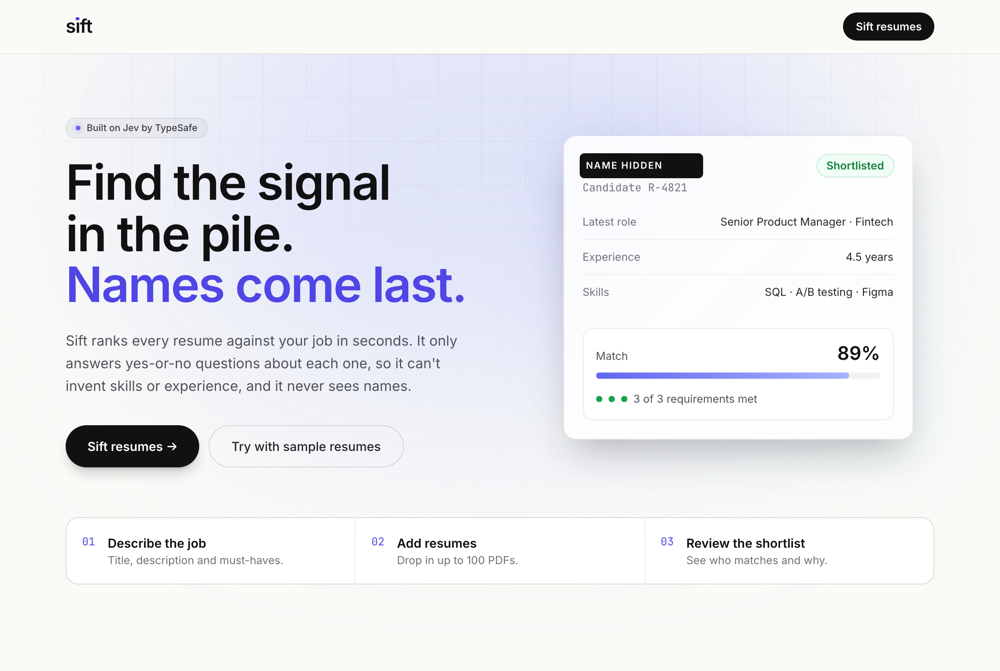
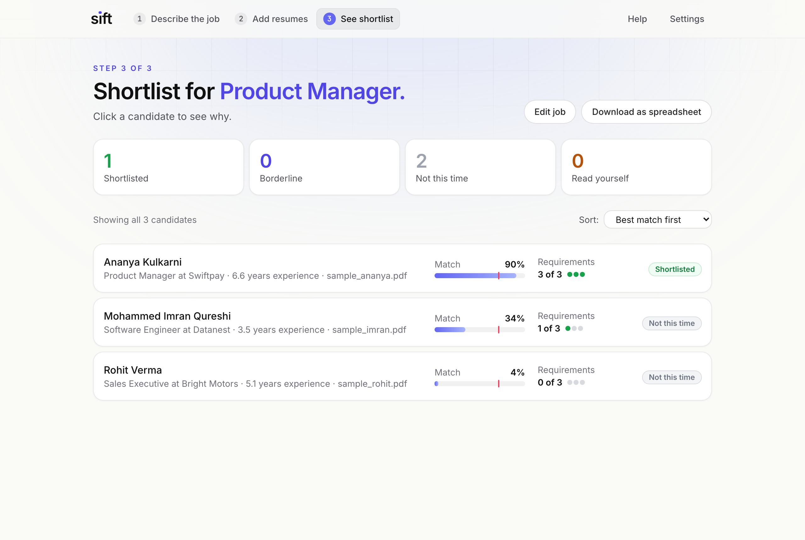
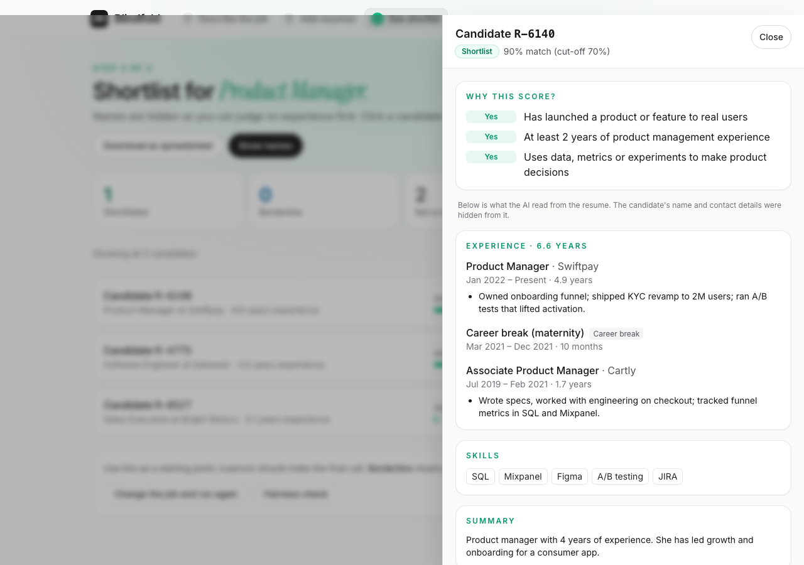

# Sift

Resume shortlisting with TypeSafe's Jev. Each resume gets a match score and a Shortlisted / Not this time suggestion. *Find the signal in the pile.* Deploys to Vercel; the candidate's name is hidden from Jev, and names stay in the recruiter's browser.

## Sift web UI

One resume per request, no server state. The same app runs on Vercel and on your laptop.

```
browser ──(one PDF + job)──▶ /api/score: parse → redact → Jev ──▶ { id, scores, redacted JSON, name_guess }
   │                                    (nothing stored, nothing logged)
   └─ keeps ID → file → name in React state; shows names only after "Reveal names"
```

### Privacy design

- **Blind by default.** Results show `R-XXXXXX` IDs, match %, verdict and requirement chips. The browser holds each resume's `name_guess` in memory but doesn't put it on the page until you click **Reveal names** and confirm.
- **Names live only in the browser tab.** The ID → filename → name map is React state: never written to localStorage, never sent back to the server. Close the tab and it's gone. The CSV export is built in the browser (IDs only until names are revealed).
- **The server forgets everything.** `/api/score` reads one PDF into memory, returns, and keeps nothing. No disk writes. The filename isn't even sent (the browser uploads every file as `resume.pdf`).
- **What Jev sees** (`BLINDFOLD_REDACTION`): `name` (default) hides the candidate's name, email, phone and profile links; city, college, dates and the rest are sent as written so recruiters can filter on them. `full` hides those too.
- **Nothing sensitive is logged.** Resume text, names and redacted JSON never reach logs; errors are logged by type only. `TYPESAFE_API_KEY` is read only by the server; `/api/health` only says whether one is set.

### API

| Endpoint | Does |
|---|---|
| `GET /api/health` | `mode` (`live`/`mock`), `has_key`, `password_required`, `demo_mode`, `redaction`, limits. Never the key. |
| `POST /api/score` | Multipart: `file` (one PDF, ≤ 4 MB), `job` (JSON), optional `mock`. Header `X-Sift-Password` for live scores. Returns `{id, probability, decision, must_haves, redacted, sections_found, warnings, name_guess, needs_human_review, mock}`. |

Errors are explicit: `413` file over 4 MB · `415` not a PDF · `401` wrong password · `429` Jev rate limit with `retry_after` (and a `Retry-After` header) · `503` key missing · unreadable PDFs come back as `needs_human_review` with a reason. The browser sends at most **5 resumes in parallel**, rejects files over 4 MB and runs over 100 files before uploading, and retries 429s with backoff (the server's hint, then doubling, up to 4 tries).

### Live vs mock

Live (real Jev) scores need **all** of: `TYPESAFE_API_KEY` set, `DEMO_PASSWORD` set, `DEMO_MODE` not `true`, and the right password typed into **Settings** (kept in memory for that tab). Otherwise every response is mock, marked `"mock": true`, and the app shows **MOCK SCORES - NOT REAL**. Off localhost, the app also shows **Demo only. Don't upload real resumes.**

### Deploy to Vercel

1. Push this folder to a Git repo and **Import** it in Vercel. `vercel.json` already sets everything: it builds `web/` into `web/dist`, deploys `api/index.py` as a Python function (Python 3.12, `maxDuration: 60`), and routes `/api/*` to it.
2. **Settings → Environment Variables** (Production and Preview):

   | Variable | Value |
   |---|---|
   | `TYPESAFE_API_KEY` | your key from console.typesafe.ai (mark it **Sensitive**) |
   | `JEV_MODEL` | `jev-1.13.0` (optional; pinned by default) |
   | `DEMO_MODE` | `true` for a public mock-only demo; leave unset to allow live scores |
   | `DEMO_PASSWORD` | a long random string you share with testers. **Unset = live mode disabled**, app runs in mock |
   | `BLINDFOLD_REDACTION` | optional: `name` (default) or `full` |

3. **Deploy.** Open the site, go to **Settings**, enter the password, and run the sample resumes.
4. **Add the firewall rate limit** (the server is stateless, so it can't count requests itself). **Project → Firewall → Configure → + New Rule**:
   - **Name:** `Sift scoring limit`
   - **If:** `Request Path` · `starts with` · `/api/score`
   - **Then:** `Rate Limit` · **Fixed Window** · **60 seconds** · **30 requests** · key: **IP Address**
   - **Follow-up action:** `Too Many Requests (429)`
   - Save, then **Publish**. That allows a 100-resume run in about 3–4 minutes per person, and the browser already backs off on 429s.

To try the Vercel runtime locally: `npm i -g vercel`, then `vercel link` and `vercel dev` from this folder (put the env vars in `.env` or `vercel env pull`).

### For recruiters: starting Sift on a Mac (no technical knowledge needed)

1. **Double-click `Start Sift.command`** in this folder. (The first time, macOS may ask you to confirm: right-click the file, choose **Open**, then **Open** again.)
2. A black window opens and sets things up. Then your browser opens Sift at **http://localhost:8000**. Keep the window open while you use it.
3. For real scores, `.env` needs `TYPESAFE_API_KEY` and `DEMO_PASSWORD` (ask your IT contact). Enter the password in **Settings**. Until then Sift shows mock scores.

Then follow the steps on screen: **Describe the job → Add resumes → See shortlist**. No resumes handy? Click **Try with sample resumes**.

**Borderline** means the score is within 5 points of the cut-off: Jev's scores vary by about ±2 points when it reads the same resume twice, so these deserve a quick human look.





### For developers

```bash
python3.11 -m venv .venv                     # typesafe-sdk needs Python 3.10+
.venv/bin/pip install -r requirements-dev.txt
cp .env.example .env                         # optional: TYPESAFE_API_KEY + DEMO_PASSWORD for live scores
.venv/bin/python start.py                    # API :8000 + Vite :5173 with hot reload → http://localhost:5173
.venv/bin/python start.py --build --open     # one server on :8000 (what the Mac launcher runs)
.venv/bin/python -m pytest tests -q
```

Mock mode needs no key: open the app and click **Try with sample resumes** (the PDFs from `tests/sample_resumes` are bundled in `web/public/samples`). `tests/test_api.py` checks that no name, email or phone from the sample resumes appears in the redacted JSON (and, in `full` mode, no city or college either), that each response carries only its own `name_guess`, and that resume content never reaches the logs.

## Command-line pipeline

## Pipeline

```
PDF -> text -> allowlisted JSON (no name, age, gender, location, college, dates)
    -> Jev (shortlist + must-have yes/no questions) -> score by ID -> map ID back to name
```

- **Structured output.** Each resume becomes `summary`, `experience` (`total_years` for full-time work, `internship_years`, and `roles[]` with `title`, `company`, `years`, `internship`, `highlights[]`), `skills[]`, `projects[]` (`name`, `highlights[]`), `certifications[]`, `achievements[]` and `education` (degree level + field only). It handles headings with durations ("Experience 2 years 8 months"), several roles under one company line, Company – Title order, dates on their own line, and bullets wrapped across lines. Structuring runs on text that has already been scrubbed, so it cannot bring back anything redaction removed.
- **Nothing is dropped silently.** Unrecognised ALL-CAPS sections are left out but listed as parser warnings in the "What Jev saw" panel, as are long blocks before the first heading.
- **Allowlist, not blocklist.** Only Summary, Experience, Skills, Projects, Certifications, Achievements and degree level are copied. The header, Personal Details, Hobbies, Languages and Declaration are never copied.
- **Scrubbed inside kept text:** names, email, phone, links, honorifics, gendered words, pronouns, age/DOB, religion/caste terms, institutions, Indian cities, calendar years.
- **Dates become durations.** Career-break lines are dropped, so gaps are not visible.
- **IDs:** `private/id_map.csv` maps ID -> file -> name. It is never sent to Jev.

## Setup

```bash
pip install -r requirements.txt
export TYPESAFE_API_KEY=ts_...
```

1. Put your JD in `config/job.json` (the current one is a placeholder).
2. Put the PDFs in `resumes/`.

## Run

```bash
python run.py --redact-only    # build redacted JSON first and read it for leaks
python run.py                  # score with Jev
python run.py --mock           # dry run with fake scores
```

Outputs go to `results/<timestamp>/`: `redacted/` (exactly what Jev saw), `audit.csv`, `scores.csv` (IDs only), `shortlist.csv` (mapped back to names).

## Measure it

```bash
python evaluate.py --labels labels.csv   # labels.csv: file,label (GO / NO-GO)
python swap_test.py --n 10               # bias swap test (command line only)
```

- Label your resumes **before** looking at Jev's output.
- `evaluate.py` prints accuracy, precision and recall across thresholds, plus the biggest disagreements.
- `swap_test.py` swaps only the name or college on the same resume and scores both the raw text and the redacted JSON. Raw spread shows how much a naive system would move. Redacted spread should be about 0 (Jev itself varies by about ±0.02 on identical input, so small spreads are noise), and `leaked=False` confirms the swapped detail never reached Jev.

## Known limits

- **Proxies can leak through the experience text** (community organisations, a women's college named inside a job line). Read `redacted/` by hand on a sample.
- **Regex parsing breaks on unusual layouts.** Two-column PDFs and scanned PDFs are flagged `HUMAN REVIEW` when nothing parses.
- **Company names are kept.** Brand bias is not removed.
- **Writing style and English fluency still come through.**
- **Jev can't invent output, but it can make the wrong decision.** Keep a human on the final shortlist.
